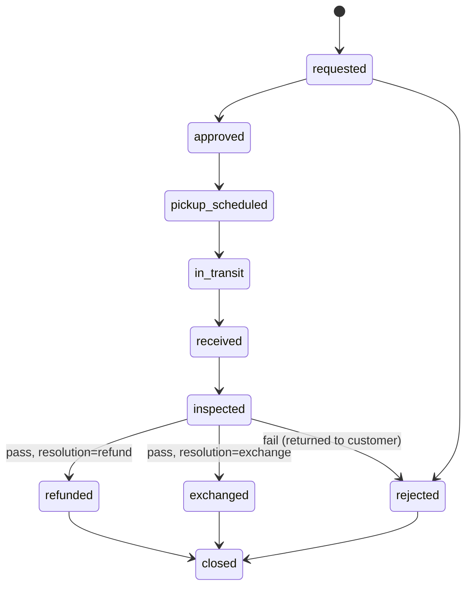

# Commerce Workflows

Every workflow below is implemented as an explicit service function (see `architecture.md` §3) and covered by service-level tests that include failure and concurrency cases.

## 1. Pricing & tax computation (`checkout.services.quote_checkout`)

1. Load cart lines with variants (and `select_for_update` only at order placement).
2. **Unit price** = `sale_price_paise` if set, else `mrp_paise`. Made-to-measure variants (size empty) carry their own price.
3. Apply **automatic promotions** by priority, then the **coupon** (if stackable rules allow). Allocate order-level discounts across lines **pro rata by line value**, with paise remainders assigned to the largest line, so per-line GST is exact.
4. **Shipping**: `ShippingRate` for (method, zone from pincode), with free-shipping thresholds and promotion effects. COD adds `CodPolicy.fee_paise`.
5. **GST** per line: `effective_unit = (line_total − line_discount) / qty`. `rate = TaxRule.for(tax_class, effective_unit, today)`. Prices are GST-inclusive, so `taxable = round(gross × 10000 / (10000 + rate_bp))` and `tax = gross − taxable`. Intra-state (seller state == place of supply) splits into CGST and SGST (half each, with the odd paise to CGST). Inter-state is IGST. Shipping and COD charges are taxed at the rate of the principal supply (configurable, and confirmed with a CA).
6. Return a `Quote` with a SHA-256 `quote_hash` over line ids, quantities, unit prices, discounts, shipping and total.

> Seed tax rules (to be confirmed by a CA): Apparel. Per-piece value ≤ ₹2,500 → 5%. Above ₹2,500 → 18% (GST rationalisation effective 22 Sep 2025). Stored as data with effective dates.

## 2. Add to cart
- Validate the variant is active, its product is published, quantity ≤ available (tracked) and ≤ 10, and an MTM line has a valid measurement profile owned by the customer.
- **No reservation at add-to-cart** (avoids stock hoarding). Availability is shown and rechecked at checkout.

## 3. Checkout & order placement

```mermaid
sequenceDiagram
  participant C as Customer (Next.js)
  participant API as Django API
  participant DB as PostgreSQL
  participant RP as Razorpay
  C->>API: POST /checkout/ (from cart)
  API->>DB: create CheckoutSession; reserve_stock(ttl=15m)
  C->>API: PATCH address, shipping, payment_method
  API-->>C: quote + quote_hash
  C->>API: POST /place-order {quote_hash} + Idempotency-Key
  API->>DB: BEGIN; lock reservations + stock; re-quote; hash match?
  API->>DB: create Order(pending_payment) + OrderLine snapshots; redeem coupon; COMMIT
  API->>RP: create order (amount=total_paise, receipt=order.number)
  API-->>C: razorpay_order_id, key_id
  C->>RP: Razorpay Checkout (UPI/card/netbanking)
  RP-->>C: payment_id, signature
  C->>API: POST /payments/razorpay/verify/
  API->>API: HMAC verify + fetch payment from RP, amount/currency match
  API->>DB: confirm_payment: Payment=captured, Order=confirmed, reservations→committed, StockMovement(sale)
  RP--)API: webhook payment.captured (dedupe; no-op if already confirmed)
  API--)C: email + SMS (on_commit Celery)
```

**Reservations**: created when the checkout session starts and extended on each step, with a TTL of 15 minutes (configurable). The beat task `inventory.release_expired_reservations` runs every minute. Payment confirmation **after** expiry still succeeds if stock is available (re-reserve under lock). Otherwise the order is flagged `needs_attention` and an automatic refund is initiated. That window is rare, so it is reported in the admin dashboard.

**Failure handling**
| Situation | Behaviour |
|---|---|
| Price/promotion changed between quote and place | `409 price_changed` + new quote. UI shows the diff and asks for re-confirmation. |
| Stock insufficient at placement | `409 out_of_stock` per line. The UI offers to adjust. |
| Double-click / network retry on place-order | The same `Idempotency-Key` returns the original order |
| Payment fails / user closes modal | Order stays `pending_payment`. The customer can retry within 30 min, and the beat task then cancels and releases stock. |
| Verify call never arrives (tab closed) | The webhook `payment.captured` / `order.paid` confirms the order |
| Signature invalid | `400 payment_verification_failed`. Logged with a security alert. Order unchanged. |
| Amount mismatch | Order flagged `needs_attention` and never auto-confirmed |

## 4. Payment confirmation (`payments.services.confirm_payment`), idempotent
```
with transaction.atomic():
    payment = Payment.objects.select_for_update().get(provider_order_id=...)
    if payment.status == CAPTURED: return payment          # idempotent
    verify amount == order.total_paise and currency == INR
    payment.status = CAPTURED; order transition → confirmed
    inventory.commit_reservations(order)                   # reserved→sold, on_hand -= qty
    orders.allocate_invoice_number(order)                  # FOR UPDATE on InvoiceSequence
    on_commit(generate_invoice_pdf.delay, notify_order_confirmed.delay)
```
Razorpay auto-capture is enabled. If a payment arrives `authorized` only, a task captures it via the API.

## 5. Webhooks (`/payments/razorpay/webhook/`)
1. Read the **raw body** and verify the `X-Razorpay-Signature` HMAC with `RAZORPAY_WEBHOOK_SECRET` (constant-time compare).
2. `INSERT … ON CONFLICT (provider, event_id) DO NOTHING`. If it already exists, return 200 immediately.
3. Process synchronously inside a transaction (fast). On an exception, mark the event `failed` and retry via a Celery task with backoff. Still return 200 so Razorpay doesn't hammer us, because we own the retry.
4. An admin view lists failed events with "reprocess".

## 6. Cash on delivery
- Eligibility: `CodPolicy.is_enabled`, pincode `cod_available`, total ≤ `max_order_paise`, no MTM lines (configurable), and the customer is not flagged for prior RTO abuse.
- Placement creates `Payment(provider=cod, status=created)`. If OTP is required, the order is `pending_payment` until OTP verification, and then becomes `confirmed`.
- On delivery (shipment `delivered` event), Payment becomes `captured` with the COD amount reconciled from the carrier remittance (manual or CSV import in admin).
- Refunds for COD orders use bank transfer / UPI payout details collected on the return, processed manually and recorded as a `Refund` with a reference.

## 7. Cancellation (`orders.services.cancel_order`)
| From state | Who | Effect |
|---|---|---|
| `pending_payment` | customer, system (timeout), staff | Release reservations. No refund. |
| `confirmed`, `processing` | customer (before packing), staff | Restock (`cancellation` movement). If paid, `initiate_refund(full)`. Coupon usage restored. |
| `shipped`+ | — | Not cancellable. Use returns. |
Partial cancellation (line-level) is staff-only and refunds the line's allocated amount, including tax.

## 8. Shipping & tracking
- Pincode check on PDP and checkout (`shipping.Pincode`).
- Staff "create shipment" for selected lines calls `ShippingProvider.create_shipment` → AWB + label stored to S3.
- Tracking comes in through the provider webhook or polling task → `TrackingEvent` → `Shipment.status` → order `fulfilment_status`. Customer notifications go out on `shipped`, `out_for_delivery` and `delivered`.
- RTO events restock on receipt and cancel or refund per payment method.

## 9. Returns & refunds



- Eligibility: delivered within `return_window_days`, product `is_returnable`, MTM non-returnable except verified defects, and quantity ≤ delivered − already returned.
- Refund amount = the line's paid amount (after allocated discounts, including GST), pro rata by quantity. Shipping is refunded only on defects or wrong items. A credit note `Invoice(kind=credit_note)` is issued.
- `initiate_refund` locks the Payment row and checks `amount_refunded + amount ≤ amount`. The Razorpay refund is created with the `Refund.id` as the receipt/idempotency reference. Status updates come through the `refund.processed` / `refund.failed` webhooks.
- Exchange creates a new zero-value order linked to the return, subject to stock.

## 10. Inventory operations
- **Adjustments**: the admin enters ± with a reason. The `StockMovement` ledger is written in the same transaction as the `StockLevel` update. The ledger is never edited. Corrections are new movements.
- **Low stock**: after any decrement, if `available ≤ low_stock_threshold` and there is no open alert, create a `LowStockAlert` and queue an email to the Inventory Manager role. Admin dashboard widget.
- **Bulk import** (CSV/XLSX): parse, validate everything, show a dry-run report (rows, errors, creates/updates), then apply in one transaction per batch of 500 rows. The import job is logged with its file kept in S3.

## 11. Made-to-measure
1. The PDP offers "Made to measure" when `fulfilment_type ∈ {made_to_measure, both}`.
2. The customer picks or creates a `MeasurementProfile`. The guided form uses `MeasurementDefinition` guidance and validates against min/max ranges.
3. The cart line references the profile. At order placement the measurements are **copied into** `OrderLine.mtm_measurements` (immutable). Later profile edits don't affect the order.
4. ETA = `mtm_lead_time_days` + shipping ETA, shown at checkout.
5. Optional staff step: "measurements confirmed" before production, logged as an `OrderStatusEvent` note.

## 12. Notifications (all via `on_commit` → Celery, deduped by `dedupe_key`)
`account_welcome`, `email_verify`, `password_reset`, `order_confirmed` (with invoice link), `payment_failed`, `order_cancelled`, `order_shipped`, `out_for_delivery`, `order_delivered` (+ review request after 5 days), `return_requested`, `return_approved`, `refund_processed`, `low_stock_alert` (staff), `abandoned_cart` (opt-in, 4h, Phase 7).
