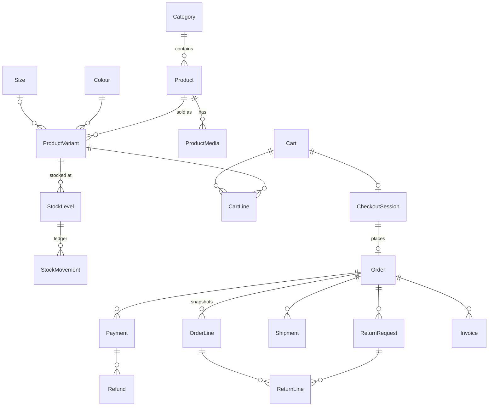

# Database Schema

PostgreSQL 17. Extensions: `pg_trgm`, `unaccent`, `citext`.

**Conventions**
- PK `id UUID` (v7, time-ordered) unless noted. Every table has `created_at` and `updated_at` (`common.models.TimeStampedModel`).
- Money is `BIGINT` **paise**, with the column suffix `_paise`. Rates are integer **basis points** (`_bp`, 1800 = 18%).
- Foreign keys default to `PROTECT` for commerce history. `SET_NULL` is used only where a snapshot preserves the data.
- Enumerations are `TextChoices` with a DB `CHECK` constraint.
- Constraints live in the DB (`UniqueConstraint`, `CheckConstraint`), not only in serializers.

---

## As-built notes (Phase 2)

These deviations from the original plan are intentional:
- `User` carries `first_name` / `last_name` (staff need names too). `email` is unique and stored lowercased, plus a case-insensitive unique constraint. `phone` is NULL-able so its unique constraint ignores users without one.
- `StockReservation` references `stock_level` and a **generic owner** (`owner_type`, `owner_id`) instead of FKs to checkout/orders, so `inventory` never depends on those apps.
- `CollectionProduct` lives in **catalog** (catalog → categories). Taxonomy apps never import catalog.
- `Product.merch_rank` drives "Featured" sort. `ProductMedia` stores `file` (S3 key via storage) and `is_placeholder`. There is no `mtm_surcharge_paise`: made-to-measure variants carry their own price.
- Category/collection banner media and `StaffAuditLog` are deferred to Phase 3 (CMS `MediaAsset`) and Phase 6 respectively.
- Extensions are installed by migration `common.0001` (`citext`, `pg_trgm`, `unaccent`, `btree_gist`) so test databases get them too.

## accounts
| Table | Key fields | Constraints / notes |
|---|---|---|
| `User` (custom, `AbstractBaseUser`) | `email citext`, `phone` (E.164, nullable), `is_active`, `is_staff`, `is_superuser`, `email_verified_at`, `last_login` | `UNIQUE(email)`, `UNIQUE(phone) WHERE phone IS NOT NULL`. Login by email. |
| Django `Group` / `Permission` | roles (see `architecture.md` §4) | Seeded by migration `accounts.0002_roles` |
| `StaffAuditLog` | `actor`, `action`, `object_type`, `object_id`, `changes jsonb`, `ip` | Append-only. Every admin write. |

## customers
| Table | Key fields | Constraints / notes |
|---|---|---|
| `CustomerProfile` | `user 1:1`, `first_name`, `last_name`, `marketing_email_opt_in`, `marketing_sms_opt_in`, `preferred_size` | |
| `Address` | `customer`, `full_name`, `phone`, `line1`, `line2`, `landmark`, `city`, `state_code` (GST state code, e.g. `27`=MH), `pincode`, `country='IN'`, `is_default_shipping`, `is_default_billing`, `gstin` (optional, B2B invoice) | `CHECK pincode ~ '^[1-9][0-9]{5}$'`. Partial unique: one default shipping per customer, one default billing per customer. |
| `MeasurementProfile` | `customer`, `label` ("Wedding fitting, Nov 2026"), `unit` (`cm`/`in`, stored as cm), `body_measurements jsonb`, `height_cm`, `weight_kg`, `posture_notes`, `schema_version` | **Body** measurements. `jsonb` validated against `catalog.MeasurementDefinition` keys. |

## categories
| Table | Key fields | Constraints / notes |
|---|---|---|
| `Category` | `parent` (self, nullable), `name`, `slug`, `path` (materialised, e.g. `wedding/sherwanis`), `depth`, `position`, `description`, `hero_media` → `cms.MediaAsset`, `seo_title`, `seo_description`, `is_active` | `UNIQUE(slug)`, `UNIQUE(path)`, `CHECK depth <= 3` |
| `Collection` | `name`, `slug`, `kind` (`manual`/`rule`), `rules jsonb` (for rule-based), `description`, `banner_media`, `mobile_banner_media`, `accent` (`emerald`/`royal`/`burgundy`), `is_published`, `starts_at`, `ends_at`, SEO fields | `UNIQUE(slug)` |
| `CollectionProduct` | `collection`, `product`, `position` | `UNIQUE(collection, product)` |

## attributes
First-class facets get typed lookup tables (integrity, fast filtering, admin dropdowns). Long-tail specs use `ProductSpecification`.

| Table | Key fields | Notes |
|---|---|---|
| `Fabric` | `name`, `slug`, `composition` ("70% silk, 30% viscose"), `description` | |
| `Occasion` | `name`, `slug`, `position` | Wedding, Reception, Sangeet, Mehendi, Haldi, Engagement, Cocktail, Festive |
| `Fit` | `name`, `slug` | Slim, Tailored, Regular, Relaxed |
| `Pattern` | `name`, `slug` | Solid, Jacquard, Brocade, Printed, Striped… |
| `EmbroideryType` | `name`, `slug`, `description` | Zardozi, Aari, Resham, Chikankari, Sequin, Threadwork, None |
| `SleeveType` | `name`, `slug` | Full, Three-quarter, Half, Sleeveless |
| `Colour` | `name`, `slug`, `hex`, `family` (for filter grouping) | `CHECK hex ~ '^#[0-9A-F]{6}$'` |
| `SizeSystem` | `name` ("Menswear chest", "Trouser waist", "Footwear UK") | |
| `Size` | `system`, `label` (`38`, `M`, `UK 9`), `sort_order` | `UNIQUE(system, label)` |

## catalog
| Table | Key fields | Constraints / notes |
|---|---|---|
| `Brand` | `name`, `slug`, `description`, `logo` | Supports in-house sub-labels / future consignment |
| `Product` | `name`, `slug`, `short_description`, `description` (sanitised rich text), `category` (PROTECT), `brand`, `fabric`, `pattern`, `embroidery`, `sleeve_type`, `fit`, `care_instructions`, `occasions M2M`, `fulfilment_type` (`ready_to_wear`/`made_to_measure`/`both`), `mtm_lead_time_days`, `size_chart`, `hsn_code`, `tax_class` → `pricing.TaxClass`, `status` (`draft`/`published`/`archived`), `published_at`, `is_returnable`, `return_window_days`, `merch_rank`, `seo_title`, `seo_description`, `og_image`, `search_vector tsvector` | `UNIQUE(slug)`. `CHECK status='published' ⇒ published_at IS NOT NULL`. GIN(`search_vector`), GIN trigram(`name`). Index(`category, status`). |
| `ProductSpecification` | `product`, `key`, `value`, `position` | e.g. "Lining: Cotton", "Closure: Hook & button" |
| `ProductMedia` | `product`, `colour` (nullable: shared by all variants of that colour), `kind` (`image`/`video`), `storage_key`, `role` (`primary`/`gallery`/`detail`/`lifestyle`/`swatch`/`video`), `alt_text` (required), `width`, `height`, `focal_x`, `focal_y`, `blurhash`, `duration_s`, `poster_key`, `position`, `processing_status` | Only real product photography. `CHECK width>=1600` for images (enforced in service at upload). |
| `ProductVariant` | `product`, `sku`, `colour` (PROTECT), `size` (nullable for MTM), `mrp_paise`, `sale_price_paise` (nullable), `inventory_policy` (`track`/`made_to_order`), `is_active`, `barcode`, `weight_grams`, `position` | `UNIQUE(sku)`. `UNIQUE(product, colour, size) NULLS NOT DISTINCT`. `CHECK mrp_paise > 0`. `CHECK sale_price_paise IS NULL OR (sale_price_paise > 0 AND sale_price_paise < mrp_paise)`. `CHECK inventory_policy='made_to_order' OR size IS NOT NULL`. |
| `SizeChart` | `name`, `size_system`, `notes` | **Garment** measurements |
| `SizeChartRow` | `size_chart`, `size`, `measurement` → `MeasurementDefinition`, `value_cm (numeric 5,1)` | `UNIQUE(size_chart, size, measurement)` |
| `MeasurementDefinition` | `key` (`chest`, `waist`, `shoulder`, `sleeve_length`, `kurta_length`, `neck`, `hip`, `inseam`…), `label`, `applies_to` (`body`/`garment`/`both`), `min_cm`, `max_cm`, `guide_text`, `guide_media` | Shared vocabulary. Body-measurement **guidance** (how to measure) lives here. |
| `CompleteTheLook` | `product`, `related_product`, `position`, `kind` (`complete_look`/`related`) | `UNIQUE(product, related_product, kind)`. `CHECK product <> related_product`. |

## inventory
| Table | Key fields | Constraints / notes |
|---|---|---|
| `StockLocation` | `name`, `code`, `address`, `state_code`, `is_default`, `is_active` | Single default warehouse at launch. Multi-location ready. |
| `StockLevel` | `variant`, `location`, `on_hand`, `reserved`, `low_stock_threshold` | `UNIQUE(variant, location)`. `CHECK on_hand >= 0`, `CHECK reserved >= 0`, `CHECK reserved <= on_hand`. Available = `on_hand − reserved`. |
| `StockReservation` | `variant`, `location`, `quantity`, `checkout_session` (nullable), `order` (nullable), `status` (`active`/`committed`/`released`/`expired`), `expires_at` | Index(`status, expires_at`). `CHECK quantity > 0`. |
| `StockMovement` | `variant`, `location`, `delta`, `reason` (`receipt`/`sale`/`cancellation`/`return`/`adjustment`/`damage`/`transfer`), `reference_type`, `reference_id`, `actor`, `note`, `balance_after` | **Append-only ledger.** No update/delete permission for any role. |
| `LowStockAlert` | `stock_level`, `triggered_at`, `resolved_at` | Partial unique: one open alert per level |

## pricing
| Table | Key fields | Notes |
|---|---|---|
| `TaxClass` | `name` ("Apparel", "Footwear", "Accessories – leather"), `code` | |
| `TaxRule` | `tax_class`, `threshold_paise` (per-unit transaction value), `rate_below_bp`, `rate_at_or_above_bp`, `effective_from`, `effective_to` | Exclusion constraint: no overlapping effective ranges per class. Seed values are confirmed with a CA before launch. |

Prices are **GST-inclusive**. The service back-calculates taxable value: `taxable = round(price × 10000 / (10000 + rate_bp))`. Intra-state supply (seller state = place of supply) splits into CGST + SGST. Inter-state supply is IGST.

## carts
| Table | Key fields | Constraints / notes |
|---|---|---|
| `Cart` | `customer` (nullable), `session_key` (nullable), `status` (`active`/`merged`/`converted`/`abandoned`), `coupon` (nullable), `last_activity_at` | Partial unique: one `active` cart per customer, one per session_key |
| `CartLine` | `cart`, `variant`, `quantity`, `measurement_profile` (nullable, MTM), `unit_price_seen_paise` (for "price changed" notice only, never charged) | `UNIQUE(cart, variant, measurement_profile) NULLS NOT DISTINCT`. `CHECK quantity BETWEEN 1 AND 10`. |

## wishlists
| `Wishlist` | `customer`, `name`, `is_default` | Partial unique default per customer |
|---|---|---|
| `WishlistItem` | `wishlist`, `product`, `variant` (nullable) | `UNIQUE(wishlist, product, variant) NULLS NOT DISTINCT` |

## checkout
| Table | Key fields | Notes |
|---|---|---|
| `CheckoutSession` | `cart`, `customer` (nullable), `email`, `phone`, `shipping_address jsonb`, `billing_address jsonb`, `shipping_method`, `payment_method` (`razorpay`/`cod`), `quote jsonb`, `quote_hash`, `status` (`open`/`completed`/`expired`), `expires_at` | Quote recomputed on every step. Order placement re-quotes and compares the hash. |

## orders
| Table | Key fields | Constraints / notes |
|---|---|---|
| `Order` | `number` (`AT-2026-000123`, prefix from settings), `customer` (nullable, guest), `email`, `phone`, `status`, `payment_status`, `fulfilment_status`, `payment_method`, `currency='INR'`, `subtotal_paise`, `discount_paise`, `shipping_paise`, `cod_fee_paise`, `tax_paise`, `total_paise`, `shipping_address jsonb`, `billing_address jsonb`, `place_of_supply_state`, `seller_state`, `coupon_code`, `idempotency_key`, `placed_at`, `cancelled_at`, `cancel_reason`, `customer_note` | `UNIQUE(number)`, `UNIQUE(idempotency_key)`. `CHECK total_paise = subtotal_paise - discount_paise + shipping_paise + cod_fee_paise`. Index(`customer, placed_at DESC`), (`status`). |
| `OrderLine` | `order`, `variant` (SET_NULL), **snapshot:** `product_name`, `product_slug`, `variant_label`, `sku`, `colour_name`, `size_label`, `image_url`, `hsn_code`, `fulfilment_type`, `mtm_measurements jsonb`, `unit_mrp_paise`, `unit_price_paise`, `quantity`, `discount_paise`, `taxable_value_paise`, `gst_rate_bp`, `cgst_paise`, `sgst_paise`, `igst_paise`, `line_total_paise`, `quantity_cancelled`, `quantity_returned` | **Immutable after insert** (enforced in `save()` and with a DB trigger blocking UPDATE of snapshot columns). |
| `OrderStatusEvent` | `order`, `field` (`status`/`payment_status`/`fulfilment_status`), `from_value`, `to_value`, `actor`, `note` | Append-only timeline |
| `InvoiceSequence` | `financial_year` (`26-27`), `last_value` | Row lock on allocation |
| `Invoice` | `order`, `number`, `kind` (`invoice`/`credit_note`), `issued_at`, `seller_snapshot jsonb` (legal name, GSTIN, address), `pdf_key`, `totals jsonb` | `UNIQUE(number)` |

**Order state machine** (`orders/state.py`):
`pending_payment → confirmed → processing → partially_shipped → shipped → delivered → completed`, with branches `→ cancelled` (from pending_payment/confirmed/processing) and `payment_failed` (from pending_payment, retryable until the session expires). COD orders enter at `confirmed` (optionally after OTP). Returns are tracked on `returns`, and the order shows `partially_returned`/`returned` as `fulfilment_status`.

## payments
| Table | Key fields | Constraints / notes |
|---|---|---|
| `Payment` | `order`, `provider` (`razorpay`/`cod`), `provider_order_id`, `provider_payment_id`, `amount_paise`, `amount_refunded_paise`, `status` (`created`/`authorized`/`captured`/`failed`/`refunded`/`partially_refunded`), `method` (upi/card/netbanking/wallet/cod), `failure_code`, `failure_reason`, `raw jsonb` | `UNIQUE(provider, provider_order_id)`, `UNIQUE(provider, provider_payment_id) WHERE NOT NULL`. `CHECK amount_refunded_paise <= amount_paise`. |
| `WebhookEvent` | `provider`, `event_id`, `event_type`, `payload jsonb`, `signature_valid`, `status` (`received`/`processed`/`ignored`/`failed`), `attempts`, `error`, `processed_at` | `UNIQUE(provider, event_id)`. This is the idempotency key. |
| `Refund` | `payment`, `order`, `return_request` (nullable), `amount_paise`, `reason`, `status` (`pending`/`processing`/`processed`/`failed`), `provider_refund_id`, `idempotency_key`, `initiated_by` | `UNIQUE(idempotency_key)`, `UNIQUE(provider_refund_id) WHERE NOT NULL`. `CHECK amount_paise > 0`. |

## shipping
| Table | Key fields | Notes |
|---|---|---|
| `ShippingZone` | `name`, `code`, `state_codes text[]` | Local / Regional / National / Remote |
| `Pincode` | `pincode` (PK), `city`, `district`, `state_code`, `zone`, `is_serviceable`, `cod_available`, `eta_days_min`, `eta_days_max` | Bulk-imported from carrier serviceability files |
| `ShippingMethod` | `code` (`standard`/`express`), `name`, `is_active` | |
| `ShippingRate` | `method`, `zone`, `min_subtotal_paise`, `max_subtotal_paise`, `fee_paise`, `free_above_paise` | Non-overlapping per (method, zone) |
| `CodPolicy` | `max_order_paise`, `fee_paise`, `require_otp`, `is_enabled` | Singleton |
| `Shipment` | `order`, `provider`, `awb`, `carrier_name`, `status` (`pending`/`label_created`/`picked_up`/`in_transit`/`out_for_delivery`/`delivered`/`rto`/`cancelled`), `tracking_url`, `label_key`, `shipped_at`, `delivered_at` | `UNIQUE(provider, awb) WHERE NOT NULL` |
| `ShipmentLine` | `shipment`, `order_line`, `quantity` | |
| `TrackingEvent` | `shipment`, `status`, `location`, `description`, `occurred_at`, `provider_event_id` | `UNIQUE(shipment, provider_event_id)` |

## promotions
| Table | Key fields | Constraints / notes |
|---|---|---|
| `Promotion` | `name`, `kind` (`percent`/`fixed_amount`/`free_shipping`), `value` (bp or paise), `max_discount_paise`, `scope` (`order`/`category`/`collection`/`product`), `scope_ids uuid[]`, `min_subtotal_paise`, `starts_at`, `ends_at`, `is_active`, `is_automatic`, `stackable`, `priority` | `CHECK kind<>'percent' OR value BETWEEN 1 AND 9000` |
| `Coupon` | `code citext`, `promotion`, `usage_limit_total`, `usage_limit_per_customer`, `times_redeemed`, `first_order_only` | `UNIQUE(code)` |
| `CouponRedemption` | `coupon`, `order`, `customer`, `email` | `UNIQUE(coupon, order)`. Count enforced under lock. |

## reviews
| `Review` | `product`, `customer`, `order_line` (verified purchase), `rating`, `title`, `body`, `fit_feedback` (`runs_small`/`true_to_size`/`runs_large`), `status` (`pending`/`approved`/`rejected`), `moderated_by`, `moderated_at` | `UNIQUE(customer, product)`. `CHECK rating BETWEEN 1 AND 5`. |
|---|---|---|
| `ReviewMedia` | `review`, `storage_key`, `alt_text`, `status` | Moderated with the review |

## returns
| Table | Key fields | Notes |
|---|---|---|
| `ReturnPolicy` | `window_days`, `mtm_returnable` (default false, defects only), `restocking_fee_bp` | Singleton, with a per-product override on `Product` |
| `ReturnRequest` | `number`, `order`, `customer`, `status` (`requested`/`approved`/`rejected`/`pickup_scheduled`/`in_transit`/`received`/`inspected`/`refunded`/`exchanged`/`closed`), `resolution` (`refund`/`exchange`/`store_credit`), `reason`, `customer_note`, `staff_note`, `refund_method` (`original`/`bank_transfer` for COD) | `UNIQUE(number)` |
| `ReturnLine` | `return_request`, `order_line`, `quantity`, `reason_code`, `condition` (on inspection), `restock` | `CHECK quantity > 0`. Service enforces ≤ deliverable − already returned. |
| `ReturnMedia` | `return_request`, `storage_key` | Damage evidence |

## cms
| Table | Key fields | Notes |
|---|---|---|
| `SiteSettings` | singleton: `brand_name`, `legal_name`, `tagline`, `logo`, `monogram`, `theme_key`, `seller_gstin`, `seller_state_code`, `registered_address`, `support_email`, `support_phone`, `social_links jsonb`, `announcement jsonb` | See `brand-identity.md` |
| `MediaAsset` | `storage_key`, `kind`, `alt_text`, `credit`, `usage_rights`, `focal_x/y`, `width`, `height`, `blurhash`, `tags`, `is_product_photo` (always false here) | Campaign / editorial library |
| `Page` | `slug`, `title`, `template` (`home`/`landing`/`content`), `seo_*` | |
| `PageVersion` | `page`, `version`, `status` (`draft`/`scheduled`/`published`/`archived`), `publish_at`, `published_by` | One published version per page (partial unique) |
| `ContentBlock` | `page_version`, `type` (`hero`, `category_grid`, `collection_feature`, `product_rail`, `occasion_tiles`, `editorial_split`, `craft_story`, `testimonials`, `instagram_gallery`, `newsletter`, `rich_text`), `position`, `config jsonb`, `visible_from`, `visible_until` | `config` validated against a per-type schema (Pydantic model in `cms/blocks.py`) |
| `Testimonial` | `name`, `quote`, `occasion`, `media`, `is_published` | Real customers only. Consent recorded. |
| `NewsletterSubscriber` | `email citext`, `status`, `source`, `consented_at`, `unsubscribed_at` | `UNIQUE(email)` |

## notifications
| `NotificationTemplate` | `key` (`order_confirmed`, `order_shipped`, …), `channel` (`email`/`sms`), `subject`, `body_html`, `body_text`, `dlt_template_id` | `UNIQUE(key, channel)` |
|---|---|---|
| `NotificationLog` | `template_key`, `channel`, `recipient_masked`, `status` (`queued`/`sent`/`failed`), `provider_message_id`, `error`, `related_type`, `related_id`, `dedupe_key` | `UNIQUE(dedupe_key)` (prevents double sends on task retry) |

## analytics
| `ProductView` / `AnalyticsEvent` | `event`, `session_id`, `customer` (nullable), `product`, `properties jsonb`, `occurred_at` | Partitioned by month (Phase 8) |
|---|---|---|
| `DailySalesSummary` | `date`, `orders`, `units`, `gross_paise`, `discount_paise`, `refunds_paise`, `net_paise`, `aov_paise`, `cod_share_bp` | Rebuilt nightly by Celery beat |

## ER overview (core commerce)

